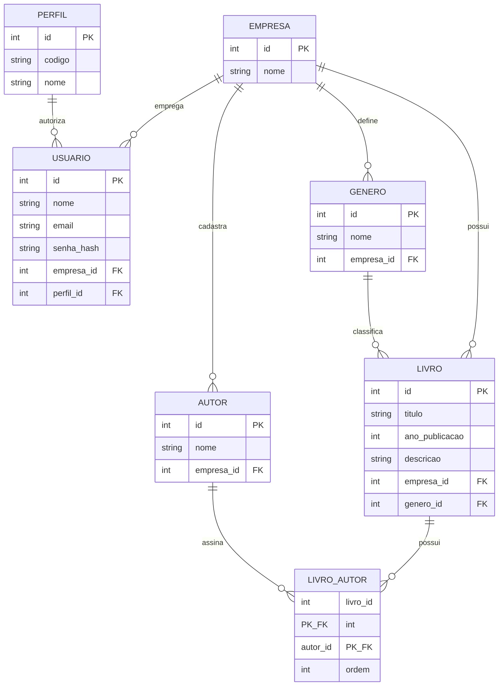

# Pseudo-modelagem do banco — BookHub

Estrutura lógica do banco do acervo de livros. O BookHub atende várias bibliotecas no mesmo sistema. Cada biblioteca é uma empresa e enxerga somente os próprios dados. O desenho ainda não escolhe um SGBD e não vale como script de criação.

## 1. Objetivo

Organizar o acervo de cada biblioteca para as operações do MVP:

- cadastrar, consultar, editar e excluir livros da própria empresa;
- pesquisar por título dentro da empresa;
- filtrar e agrupar obras por gênero dentro da empresa;
- autenticar pessoas e limitar o que cada uma faz pelo perfil.

Cada livro guarda título, autor, gênero, ano de publicação e descrição, e pertence a uma única empresa.

## 2. Multiempresa

Um sistema, várias empresas. A separação adotada é a coluna `empresa_id` na mesma tabela. Toda consulta, inclusão, alteração e exclusão filtra pela empresa da pessoa autenticada.

| Forma de separar | Como funciona | Situação neste desenho |
| --- | --- | --- |
| Um banco por empresa | Cada biblioteca tem o próprio banco. O isolamento é maior e a manutenção custa mais | não adotada |
| Um schema por empresa | O mesmo banco guarda uma pasta por biblioteca | não adotada |
| Coluna `empresa_id` | As bibliotecas compartilham as tabelas. A coluna identifica o dono de cada linha | adotada |

O mesmo título pode existir em duas bibliotecas. São duas linhas, com `id` diferente e `empresa_id` diferente.

| id | empresa_id | titulo |
| --- | --- | --- |
| 1 | 1 | O Cortiço |
| 2 | 1 | Capitães da Areia |
| 3 | 2 | O Cortiço 2 |
| 4 | 2 | Grande Sertão: Veredas |

| empresa_id | Biblioteca |
| --- | --- |
| 1 | Livraria Aurora |
| 2 | Biblioteca do Porto |

A Livraria Aurora vê as linhas 1 e 2. A Biblioteca do Porto vê as linhas 3 e 4.

## 3. Perfis de acesso

Há três perfis fixos: `admin`, `cliente` e `usuario`. A pessoa sempre atua dentro da empresa à qual está vinculada. Nenhum perfil lista dados de outra biblioteca.

| codigo | Perfil | O que faz na própria empresa |
| --- | --- | --- |
| admin | Admin | Função principal: administrar usuários. Também pode consultar e alterar todo o acervo |
| cliente | Cliente | Faz tudo no acervo: cadastra, edita, consulta e exclui livros, gêneros e autores. Não administra usuários |
| usuario | Usuário | Consulta, busca e filtra o acervo |

| Ação | admin | cliente | usuario |
| --- | --- | --- | --- |
| Listar, buscar e filtrar o acervo da própria empresa | sim | sim | sim |
| Cadastrar, editar e excluir livro, gênero e autor | sim | sim | não |
| Gerenciar usuários da própria empresa | sim | não | não |

## 4. Visão geral

A empresa delimita o acervo e as pessoas. O perfil diz o que a pessoa pode fazer. Gênero e autor ficam em entidades próprias, sempre da mesma empresa do livro.

## 5. Entidades

### 5.1 Empresa

Biblioteca que usa o BookHub. É o limite dos dados.

| Atributo | Descrição | Tipo | Restrições |
| --- | --- | --- | --- |
| id | Identificador da empresa | inteiro | chave primária |
| nome | Nome da biblioteca | texto | obrigatório |

### 5.2 Perfil

Catálogo fixo dos três papéis do sistema. Vale para todas as empresas.

| Atributo | Descrição | Tipo | Restrições |
| --- | --- | --- | --- |
| id | Identificador do perfil | inteiro | chave primária |
| codigo | `admin`, `cliente` ou `usuario` | texto | obrigatório, único |
| nome | Admin, Cliente ou Usuário | texto | obrigatório |

Carga inicial:

| id | codigo | nome |
| --- | --- | --- |
| 1 | admin | Admin |
| 2 | cliente | Cliente |
| 3 | usuario | Usuário |

### 5.3 Usuário

Pessoa que entra no sistema. Pertence a uma empresa e a um perfil.

| Atributo | Descrição | Tipo | Restrições |
| --- | --- | --- | --- |
| id | Identificador do usuário | inteiro | chave primária |
| nome | Nome da pessoa | texto | obrigatório |
| email | E-mail usado para entrar | texto | obrigatório, único |
| senha_hash | Senha armazenada apenas como hash | texto | obrigatório |
| empresa_id | Biblioteca da pessoa | inteiro | obrigatório, chave estrangeira para `empresa.id` |
| perfil_id | Papel da pessoa | inteiro | obrigatório, chave estrangeira para `perfil.id` |

### 5.4 Gênero

Categoria usada para organizar e filtrar o acervo de uma empresa. O mesmo nome pode existir em outra biblioteca, em outra linha.

| Atributo | Descrição | Tipo | Restrições |
| --- | --- | --- | --- |
| id | Identificador do gênero | inteiro | chave primária |
| nome | Nome da categoria, como Romance ou Ficção | texto | obrigatório |
| empresa_id | Biblioteca dona da categoria | inteiro | obrigatório, chave estrangeira para `empresa.id` |

O par `(empresa_id, nome)` é único.

### 5.5 Autor

Pessoa responsável por obras de uma biblioteca. O cadastro vale para o acervo dessa empresa.

| Atributo | Descrição | Tipo | Restrições |
| --- | --- | --- | --- |
| id | Identificador do autor | inteiro | chave primária |
| nome | Nome do autor | texto | obrigatório |
| empresa_id | Biblioteca dona do cadastro | inteiro | obrigatório, chave estrangeira para `empresa.id` |

### 5.6 Livro

Obra do acervo de uma biblioteca. É a entidade das telas de listagem, cadastro, edição, exclusão e busca.

| Atributo | Descrição | Tipo | Restrições |
| --- | --- | --- | --- |
| id | Identificador do livro | inteiro | chave primária |
| titulo | Nome da obra | texto | obrigatório |
| ano_publicacao | Ano em que a obra foi publicada | inteiro | obrigatório |
| descricao | Texto curto sobre a obra | texto | obrigatório |
| empresa_id | Biblioteca dona da obra | inteiro | obrigatório, chave estrangeira para `empresa.id` |
| genero_id | Gênero ao qual a obra pertence | inteiro | obrigatório, chave estrangeira para `genero.id` |

A busca por título usa `titulo` junto com `empresa_id`. O filtro por categoria usa `genero_id`, que já pertence à mesma empresa.

### 5.7 Livro_autor

Ligação entre livro e autor. Existe porque o relacionamento é de muitos para muitos.

| Atributo | Descrição | Tipo | Restrições |
| --- | --- | --- | --- |
| livro_id | Livro da ligação | inteiro | chave primária e estrangeira para `livro.id` |
| autor_id | Autor da ligação | inteiro | chave primária e estrangeira para `autor.id` |
| ordem | Posição do autor na capa, começando em 1 | inteiro | obrigatório |

A chave primária composta `(livro_id, autor_id)` impede o mesmo autor de ser vinculado duas vezes à mesma obra.

## 6. Relacionamentos

| Relacionamento | Cardinalidade | Como ler |
| --- | --- | --- |
| Empresa possui Livro | 1:N | Uma biblioteca tem vários livros. Cada livro pertence a uma biblioteca. |
| Empresa define Gênero | 1:N | Uma biblioteca define vários gêneros. Cada gênero pertence a uma biblioteca. |
| Empresa cadastra Autor | 1:N | Uma biblioteca cadastra vários autores. Cada autor pertence a uma biblioteca. |
| Empresa emprega Usuário | 1:N | Uma biblioteca tem vários usuários. Cada usuário pertence a uma biblioteca. |
| Perfil autoriza Usuário | 1:N | Um perfil é usado por vários usuários. Cada usuário tem um perfil. |
| Gênero classifica Livro | 1:N | Um gênero agrupa vários livros da mesma biblioteca. Cada livro tem um gênero. |
| Livro possui Autor | N:N | Um livro tem um ou mais autores. Um autor assina zero ou mais livros da mesma biblioteca. |
| Livro_autor | associativa | Materializa o N:N e guarda a ordem dos autores. |

Regras de integridade:

- toda leitura e toda gravação de livro, gênero, autor e usuário filtram `empresa_id` pela empresa da sessão;
- o gênero do livro pertence à mesma empresa do livro;
- cada autor ligado ao livro pertence à mesma empresa do livro;
- a função principal do `admin` é gerenciar os usuários da própria empresa; ele também pode consultar e alterar todo o acervo;
- o `cliente` consulta e altera livros, gêneros e autores da própria empresa, e não gerencia usuários;
- o `usuario` apenas consulta, busca e filtra o acervo da própria empresa;
- ao excluir um livro, as linhas correspondentes em `livro_autor` também saem;
- um gênero referenciado por algum livro permanece no banco;
- todo livro cadastrado aponta para um gênero já existente e para ao menos um autor.

## 7. Exemplo

Acervo, no formato da coluna `empresa_id`:

| id | empresa_id | titulo | Biblioteca |
| --- | --- | --- | --- |
| 1 | 1 | O Cortiço | Livraria Aurora |
| 2 | 1 | Capitães da Areia | Livraria Aurora |
| 3 | 2 | O Cortiço | Biblioteca do Porto |
| 4 | 2 | Grande Sertão: Veredas | Biblioteca do Porto |

Pessoas no mesmo banco:

| Pessoa | Empresa | Perfil | O que vê ao listar livros |
| --- | --- | --- | --- |
| Ana | Livraria Aurora | admin | Administra os usuários da Aurora. Também vê e pode alterar O Cortiço e Capitães da Areia |
| Carla | Livraria Aurora | cliente | Vê e pode alterar O Cortiço e Capitães da Areia. Não administra usuários |
| Bruno | Livraria Aurora | usuario | O Cortiço e Capitães da Areia, somente consulta |
| Diego | Biblioteca do Porto | admin | O Cortiço e Grande Sertão: Veredas |

A busca por “O Cortiço” feita pela Ana devolve a linha 1. A mesma busca feita pelo Diego devolve a linha 3.

## 8. Fora deste desenho

Empréstimo, avaliação, editora e estoque ficam de fora até entrarem no escopo do produto. Banco separado por empresa e schema separado por empresa também ficam de fora: a separação deste modelo é a coluna `empresa_id`.
